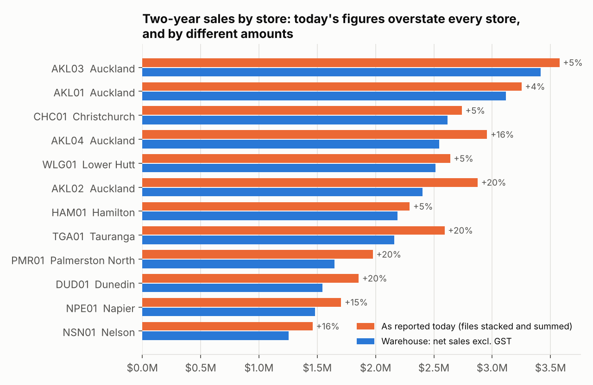
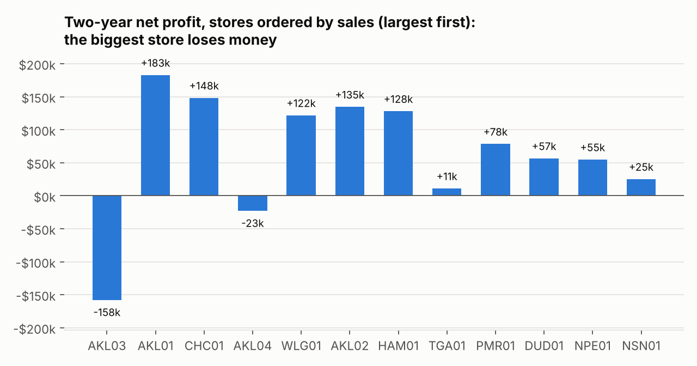
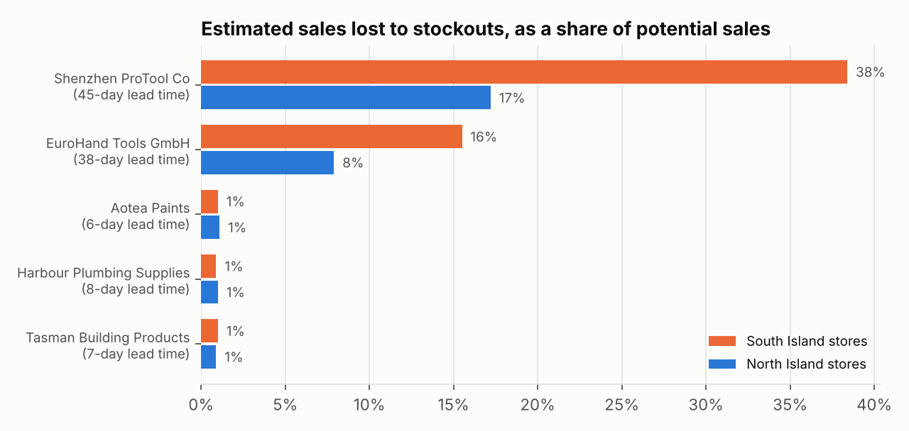
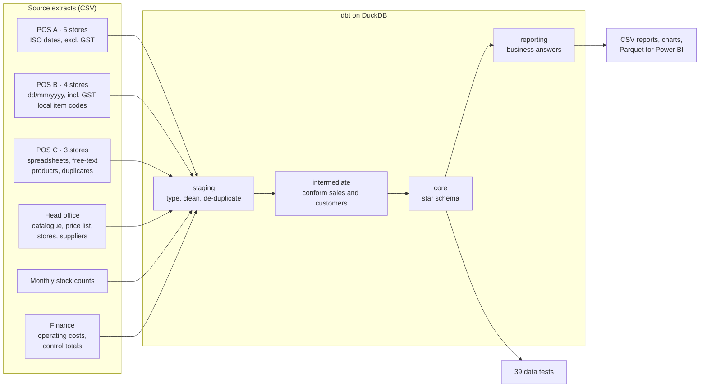
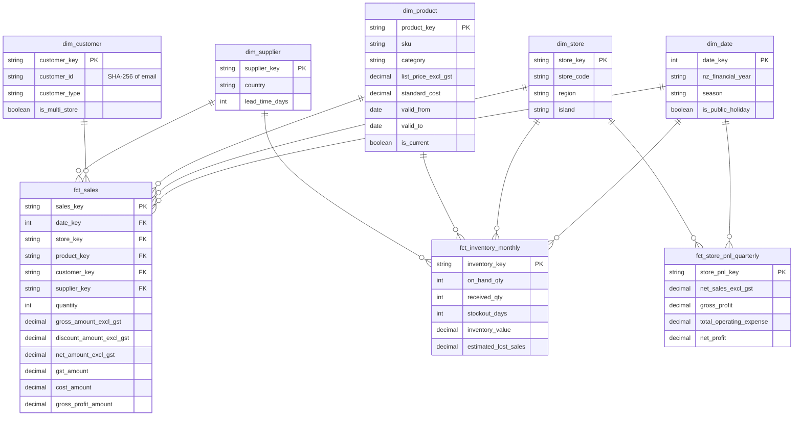

# One version of the truth for a twelve-store hardware co-operative

[](https://github.com/NamrataDatta04/Data-warehousing-project/actions/workflows/ci.yml)

A data warehouse, built with **dbt, SQL and Python**, that turns the mismatched sales files of twelve
owner-operated New Zealand hardware stores into one tested star schema, and uses it to answer the
questions head office could not answer before.

> **About the data.** Kererū Hardware Co-operative is fictional. Every store, supplier, customer,
> price and transaction is synthetic and is created by a seeded script in this repository. No real
> company's data is used. The figures below are what the pipeline finds in that synthetic data.

## The problem

Owner-operated co-operatives are a familiar New Zealand business model: each store is its own
business, with its own till system and its own habits. Kererū's head office receives a pile of files
every quarter and stacks them in a spreadsheet. That spreadsheet is wrong in ways nobody can see:

| What goes wrong | Why |
|---|---|
| Stores cannot be compared | Five stores report prices **excluding GST**, seven report them **including the 15% GST** |
| Refunds inflate sales | One till flags refunds, one uses a row type, one uses negative quantities |
| The same sale is counted twice | Spreadsheet stores sometimes export the same week twice |
| Products do not line up | One till uses store-local item codes, the spreadsheet stores type product names by hand |
| Customers cannot be followed | Customer number 12 is a different person in every store; a builder who buys at three stores is three customers |
| Profit is unknown | Sales, stock counts and operating costs arrive at different levels of detail and are never joined |

## What the warehouse found

Two years of trading (1 July 2024 to 30 June 2026), 299,593 sale lines received from 12 stores.

**1. Today's figures overstate sales by $3.0 million (11.3%), and unevenly.**
Stacked files add up to $29.92M; true net sales excluding GST are $26.90M. The error is 4–5% in
GST-exclusive stores and 15–20% in GST-inclusive ones, so the store league table is wrong: Manukau
is reported 3rd and is really 4th, Henderson is reported 4th and is really 6th, and Christchurch
moves from 5th to 3rd.



**2. The biggest store is the least profitable.**
Mt Wellington (AKL03) has the highest sales ($3.41M) and a two-year net loss of $158k. Its gross
margin is normal; its rent is 16.4% of sales against 3.5–5.7% everywhere else.



**3. Two stores are giving away margin through trade discounts.**
Manukau and Tauranga discount trade customers by 24.0% and 22.0%; the co-op median is 10.0%. That
gap is worth about $370k over two years and leaves both stores close to break-even.

**4. One overseas supplier is costing an estimated $1.79M in lost sales.**
Power tools from a supplier with a 45-day lead time are out of stock 5.3 days a month in North
Island stores and 11.5 days a month in the South Island, where an estimated 38% of potential
sales are lost.



**5. Timber and building supplies absorbed a cost increase they did not pass on.**
On 1 April 2025 costs rose 9% and list prices 3%. Timber margin fell from 15.3% to 10.4% and
building supplies from 17.7% to 12.8%, about $170k of gross profit since.

**6. Trade customers are 9% of known customers and 49% of sales.**
927 trade accounts bring in $13.3M at a 22.2% margin; retail and walk-in sales earn 35.2%. Around
95% of trade customers are still buying each quarter, against 41–47% of retail loyalty members.
Ninety trade customers buy at more than one store ($1.59M), which no single store's data can show.

All figures come from the tables in [`reports/`](reports). CI regenerates the data, rebuilds the warehouse and reruns every test on each push.

## How it works



### The model

Three fact tables at three different grains share conformed dimensions (a fact constellation), so
sales, stock and profit can be analysed together without double counting.



| Table | Grain | Notes |
|---|---|---|
| `fct_sales` | One product on one transaction in one store | 299,144 rows. GST-exclusive, refunds negative |
| `fct_inventory_monthly` | One product in one store for one month | Periodic snapshot; stock and stockout days are semi-additive |
| `fct_store_pnl_quarterly` | One store for one quarter | Revenue and cost from `fct_sales`, operating costs from finance |
| `dim_product` | One product per price-list version | **Slowly changing dimension, type 2**: sales are costed at the price list in force on the day |
| `dim_customer` | One person across all stores | Matched on a hashed email; walk-ins map to an `UNKNOWN` row |
| `dim_date` | One day | NZ financial year (April–March), southern-hemisphere seasons, national public holidays including Matariki |
| `dim_store`, `dim_supplier` | One store, one supplier | |

### Design decisions

- **GST is normalised once, in staging.** Everything downstream is GST-exclusive, with GST carried as its own measure.
- **Customer identity is the email, never the store's customer number.** Emails are cleaned and
  replaced by a SHA-256 hash in staging. No name, email or address reaches the warehouse tables,
  which keeps personal information to the minimum the analysis needs, in the spirit of the Privacy Act 2020.
- **Source files are read as text and typed explicitly**, so a bad date or amount fails the build instead of being silently guessed.
- **Duplicates are removed by rule, and the rule is tested.** A row repeated in every column is a
  double export. 449 such rows are removed.
- **The warehouse must agree with finance.** A test compares every store-quarter with finance's
  control totals and fails if any differs by more than 0.05%.

### Tests

`dbt build` runs 39 tests: primary-key uniqueness, foreign keys from every fact to every dimension,
accepted values, and five business rules in [`tests/`](tests):

| Test | Proves |
|---|---|
| `assert_sales_reconcile_to_finance_control_totals` | Warehouse sales match finance for all 96 store-quarters |
| `assert_no_duplicate_sale_lines` | De-duplication worked |
| `assert_product_versions_do_not_overlap` | Exactly one price-list version per product per day |
| `assert_pnl_revenue_matches_sales_fact` | The profit and loss and the sales fact give the same revenue |
| `assert_discounts_are_plausible` | GST conversion and price-list joins produced sensible discounts |

Switching off the de-duplication makes the first two fail, which is how I checked they do their job.

## Run it yourself

Requires Python 3.10 or later. Nothing else to install or sign up for; the warehouse is a local DuckDB file.

```bash
git clone https://github.com/NamrataDatta04/Data-warehousing-project.git
cd Data-warehousing-project
pip install -r requirements.txt

python scripts/generate_source_data.py     # writes 136 source files to data/raw (about 3 seconds)
dbt build --profiles-dir .                 # builds 33 models and runs 39 tests (about 10 seconds)
python scripts/build_report.py             # writes reports/*.csv and docs/img/*.png
```

To explore the result:

```bash
python -c "import duckdb; print(duckdb.connect('warehouse/kereru.duckdb').sql('select * from reporting.rpt_store_scorecard'))"
```

For Power BI or Tableau, `python scripts/build_report.py --export-star` writes the eight star-schema
tables to `exports/` as Parquet files; relate them on the `_key` columns.

## Repository layout

```
scripts/generate_source_data.py   seeded generator for the twelve stores' source files
scripts/build_report.py           exports reports, charts and Parquet files
models/staging/                   one model per source file: typing, cleaning, GST, de-duplication
models/intermediate/              conformed sales and customers; the "as reported" baseline
models/marts/core/                dimensions and facts
models/marts/reporting/           one model per business question
tests/                            business-rule tests
seeds/nz_public_holidays.csv      national public holidays, July 2024 to June 2026
reports/                          report output
.github/workflows/ci.yml          generates data, builds and tests on every push
```

## SQL techniques used

Window functions (`RANK`, `LAG`, `LEAD`, `FIRST_VALUE`, moving averages), `GROUP BY ROLLUP` with
`GROUPING()`, common table expressions, type 2 slowly changing dimension joins on date ranges,
cohort analysis, surrogate keys, regular expressions for cleaning, and Jinja macros in dbt.

## Limits and next steps

- The data is synthetic, so the findings show what the model can surface, not facts about any real business.
- Lost sales are an estimate: the sales rate on in-stock days applied to out-of-stock days.
- Regional anniversary days are not in the holiday calendar; only national public holidays are.
- The SQL is written for DuckDB. Moving to Snowflake or Databricks would mean replacing the CSV
  readers in `models/staging/_sources.yml` with loaded tables and adjusting a few functions; I have not run it there.
- Natural next steps: incremental loads for `fct_sales`, a Power BI report on the exported tables, and scheduled runs.

## Licence

MIT. See [LICENSE](LICENSE).
